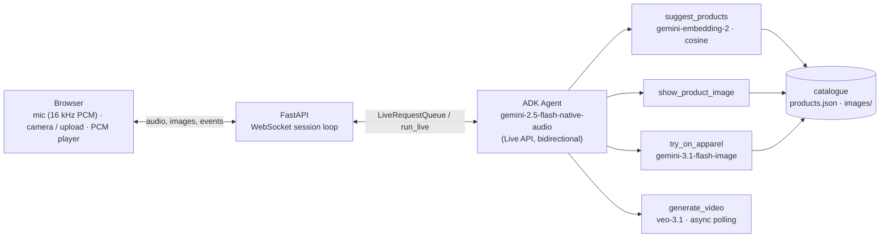

# geminAIse

A voice-driven personal shopper and virtual try-on agent, built on the Google Agent Development Kit (ADK) and the Gemini Live API.

You talk to it. It searches a product catalogue by meaning, shows you the item, dresses you in it from a photo you upload, and is wired to render a short video of the outfit in motion (not working yet). Audio streams both ways over a WebSocket, so you can interrupt it mid-sentence.

I built geminAIse solo in about three days for the [Gemini Live Agent Challenge](https://geminiliveagentchallenge.devpost.com/), with AI-assisted coding; I did not submit it in time. The agent design and tool contracts, the FastAPI WebSocket session loop, the audio pipeline and the fix for the event-loop stalls are my work; the rest I reviewed and shaped. It is a working prototype, not a product; the [limitations](#known-limitations-and-the-path-to-production) section says where the line is.

## What it does

- **Conversational commerce.** The user speaks; the agent answers in real time with voice, keeps context, and can be interrupted. It is instructed to recommend only products that exist in the catalogue.
- **Virtual try-on.** From a webcam capture or an uploaded photo, the agent generates an image of the user wearing the chosen item, asked to keep face, hair and body type.
- **Outfit video (wired, not working).** A `generate_video` tool starts a Veo 3.1 image-to-video job in the background and polls for the result. In my tests the job never returned a video; the agent reports "rendering" and nothing arrives. It is left in as work in progress, not as a feature.

A typical session:

1. "What do you have that's cozy?" → `suggest_products` embeds the query, returns the three closest catalogue items.
2. "Show me the blazer." → `show_product_image` pushes the product photo to the screen.
3. "Let me try it on." → the user uploads a photo; `try_on_apparel` generates the image and pushes it to the screen.

## Architecture



| Component | Model / service | Endpoint |
|---|---|---|
| Live agent (voice, tool calling) | `gemini-2.5-flash-native-audio-preview-12-2025` via ADK `Runner.run_live`, `StreamingMode.BIDI` | Google AI Studio (Live API `v1alpha`) |
| Semantic product search | `gemini-embedding-2-preview`, cosine similarity over normalised vectors | Vertex AI |
| Virtual try-on | `gemini-3.1-flash-image-preview`, user photo + product reference image | Google AI Studio |
| Outfit video (not working) | `veo-3.1-generate-001`, image-to-video, 9:16, 5 s | Vertex AI |
| Catalogue | 10 women's tops and bottoms from the public BigQuery dataset `thelook_ecommerce`; product photos generated once with `gemini-3.1-flash-image-preview` | BigQuery |

Two platforms, on purpose. Google serves Gemini on two surfaces with separate model catalogues: Google AI Studio (the Gemini API, authenticated with an API key) and Vertex AI (Google Cloud project, ADC). When I built this (March 2026) the native-audio Live model existed only as `gemini-2.5-flash-native-audio-preview-12-2025` on the AI Studio side; Vertex AI carries it under a different ID (`gemini-live-2.5-flash-native-audio`). So the Live agent and image generation use the API key, embeddings and Veo use Vertex AI. The Live session stays on the API key because `GOOGLE_GENAI_USE_VERTEXAI` is unset (that is the switch in the Google GenAI SDK); `app/main.py` additionally strips the project and location variables from the environment and hands them to the two Vertex modules as `GEMINAISE_GCP_*`. In production I would pick one platform, Vertex AI, for the data-governance terms (see below).

## Design decisions

- **Slow tool calls run off the event loop.** Image generation takes seconds; run inline it stalled the ASGI loop and the Live connection dropped with `1006 keepalive ping timeout`. Every blocking call (embeddings, image generation, Veo polling) goes through `asyncio.to_thread`.
- **Video is fire-and-poll.** `generate_video` starts the Veo operation, returns immediately so the agent can say "it's rendering", and a background task polls every 10 s and pushes the MP4 to the browser when it is done. The design is sound; the Veo call itself never completed in my tests, and I have not yet found out why.
- **Catalogue grounding in the instruction.** The agent is told it stocks only what `suggest_products` returns and must confirm the matched product before trying it on. This is the hallucination guard for products; it is a prompt rule, not a hard constraint. One exception by design: a photo upload injects a text turn that tells the agent to call `try_on_apparel` immediately, so after an upload the confirmation step is skipped.
- **Content safety at the generation boundary.** The try-on call sets all four harm categories to `BLOCK_LOW_AND_ABOVE`; the Veo call carries a negative prompt. The prompt asks for a fully clothed, safe-for-work result.
- **Embeddings are computed once and cached** (`data/product_embeddings.pkl`), so a restart does not re-embed the catalogue.
- **Tool results are plain strings written for the voice model**: what happened and what to tell the user. Images and videos reach the browser as side-channel messages on the same WebSocket, not through the model.

## Security and safety

Where the user's photo goes, and what that means:

- The photo is held in process memory and sent to Google twice: into the Live session (so the agent can see it) and to the image model for the try-on. It is not written to disk by the app. The generated images and videos are written to `app/static/tryon_images/` and `tryon_videos/`, both excluded from git.
- Both calls go through the AI Studio API key. Under the [Gemini API terms](https://aistudio.google.com/docs/terms), content sent via *unpaid* quota may be used to improve Google's products and may be read by human reviewers; the terms say not to submit personal information that way. With a billed Cloud project the paid terms apply (no training on your content, logging only for abuse detection), and in the EEA, Switzerland and the UK the paid terms apply regardless. For anything beyond a personal demo this means a billed project at minimum, and Vertex AI with its Data Processing Addendum as the real answer.
- No personal data in the catalogue: a public dataset and generated product photos.
- Content filters on image generation and a negative prompt on video generation (see above).
- Credentials come from the environment: Application Default Credentials for Vertex AI, an API key for AI Studio. Nothing is in the code.

Not in place, and first on a production list: authentication, per-user isolation of uploaded photos (see below), input screening of prompts and uploads, retention and deletion of generated media, and a review step for off-brand output.

## Known limitations and the path to production

Honest list, mapped to what production would need.

| Today | Why it is a problem | Production approach |
|---|---|---|
| `InMemorySessionService` | state is lost on restart, single process only | ADK persistent `SessionService` (database) or Vertex AI Agent Engine sessions |
| Uploaded photos and try-on results live in module-level dicts; `try_on_apparel` takes the most recently uploaded photo, not the caller's | two concurrent users can get each other's photo | key all state by session and pass the session id into the tools (ADK `ToolContext`); store media per session |
| No tests, no evals | regressions in tool behaviour or prompt changes go unnoticed | unit tests per tool with the client mocked at the boundary; ADK eval sets with expected tool trajectories; a fixture catalogue for ranking tests |
| `print` statements, `DEBUG` log level | no latency, cost or outcome per tool call; the keepalive drops were found by accident, not by a trace | one logger per module, structured; a trace per turn with tool name, latency and outcome; time-to-first-audio p50/p95, tokens and cost per session |
| `suggest_products` always returns the top 3, whatever the score | a query with no match still gets a confident answer | a similarity floor tuned on a labelled should-answer / should-decline set; below it the agent says it has nothing suitable |
| Tools return free-text strings; a failed tool returns an apology string | the model can talk over a failure as if it succeeded | typed tool results (status + payload), retry or explicit hand-off on failure, and an output check in code that the named product is in the catalogue |
| Catalogue of 10 items, embeddings in a pickle, no invalidation | fine for a demo, does not scale, stale after a catalogue edit | Vertex AI Vector Search or an embedding column in BigQuery/AlloyDB; re-index on edit; attributes (colour, size, price) as filters |
| Retrieval is semantic only | "Levi's 501" matches on meaning, not on the exact brand or SKU | hybrid retrieval: keyword (BM25) plus embeddings, fused with reciprocal rank fusion — what Vertex AI Vector Search offers as hybrid search |
| Generated media written to `app/static/` and served by the app | unbounded disk, no access control | Cloud Storage with signed URLs and a lifecycle rule |
| Runs locally; Dockerfile untested on Cloud Run | no deployment | Cloud Run with Secret Manager for the API key and a service account for Vertex AI |
| Video generation does not complete | the Veo operation never returned a video in my tests; cause not yet diagnosed | debug the operation result handling against the current Veo API; keep it opt-in; evaluate Veo versions on a fixed set of try-on images |
| Identity preservation is best-effort | the generated person does not always look like the user; the prompt asks the model to keep face and body, nothing enforces it | a dedicated virtual try-on model (Vertex AI offers one) or a face-consistency check on the output before showing it |

## Project structure

```
app/
  main.py                     FastAPI app: HTTP routes, the WebSocket session loop, ADK Runner wiring
  geminaise_agent/
    agent.py                  ADK Agent definition, system instruction, the four tools
    semantic_search.py        catalogue embeddings (Vertex AI), cosine search, disk cache
    video_manager.py          background polling of a Veo operation, saves the MP4
  static/js/
    app.js                    UI logic: camera / upload, mic capture, WebSocket client, renders agent events
    audio-worklet.js          microphone → 2048-sample chunks (app.js converts to 16-bit PCM at 16 kHz)
    pcm-player-processor.js   plays the agent's PCM audio
    audio-player.js           AudioWorklet setup for playback
  templates/index.html        single page: input photo on the left, result on the right
src/
  extract_products.py         pulls 10 products from the BigQuery public dataset → data/products.json
  generate_images.py          generates one product photo per item → data/images/
data/
  products.json, images/      the catalogue, shipped with the repo
Dockerfile                    container image for Cloud Run (port 8080)
pyproject.toml, uv.lock       dependencies, managed with uv
```

## Running locally

Prerequisites: Python 3.11, [uv](https://docs.astral.sh/uv/), the `gcloud` CLI, a Google Cloud project with the Vertex AI API enabled, and a Gemini API key from [AI Studio](https://aistudio.google.com/).

```bash
cp .env.example .env            # fill in GOOGLE_API_KEY and GOOGLE_CLOUD_PROJECT
gcloud auth application-default login
uv sync
cd app && uv run uvicorn main:app --reload --port 8000
```

Open http://localhost:8000. The first start embeds the 10 catalogue items (one Vertex AI call each) and caches the result.

The catalogue is included. To regenerate it, from the repository root: `uv run src/extract_products.py` (BigQuery; the query has no `ORDER BY`, so you get a different 10 items each time) and then `uv run src/generate_images.py` (image generation, paid calls; delete `data/images/` first, existing files are skipped).

Container: `docker build -t geminaise . && docker run -p 8080:8080 --env-file .env geminaise`. The Dockerfile installs from `pyproject.toml`, not from the lock file, and Vertex AI inside the container needs a service account or mounted ADC; this has not been tested on Cloud Run yet.

## What's next

Multi-item try-on (a full outfit in one image), more catalogue attributes as search filters, the production items above in the order listed, and a mobile client for the camera-and-voice flow.
